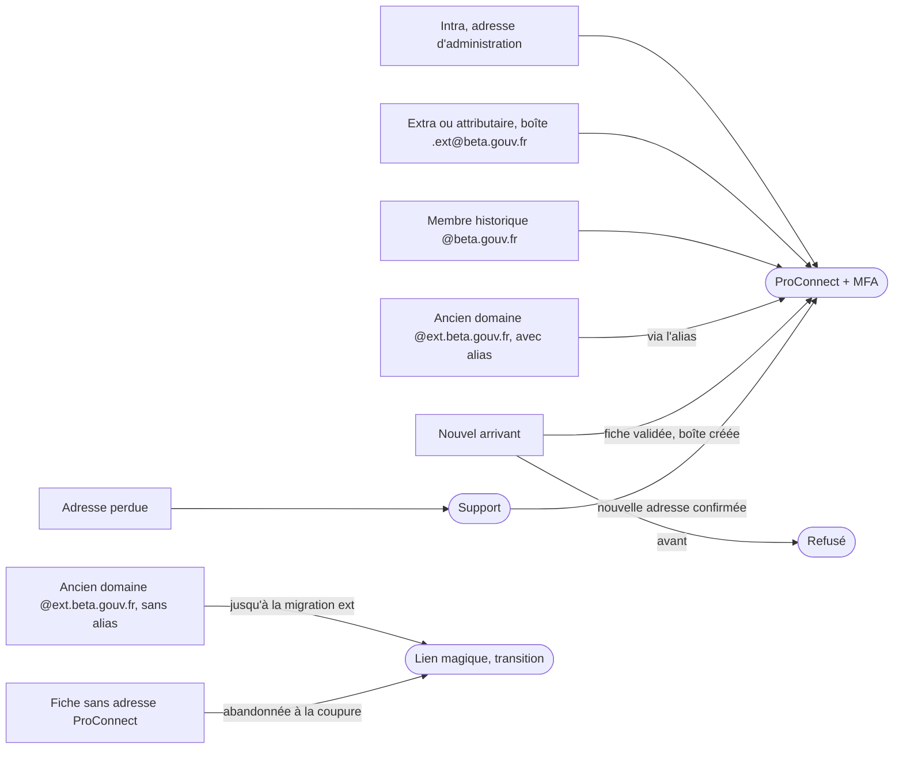
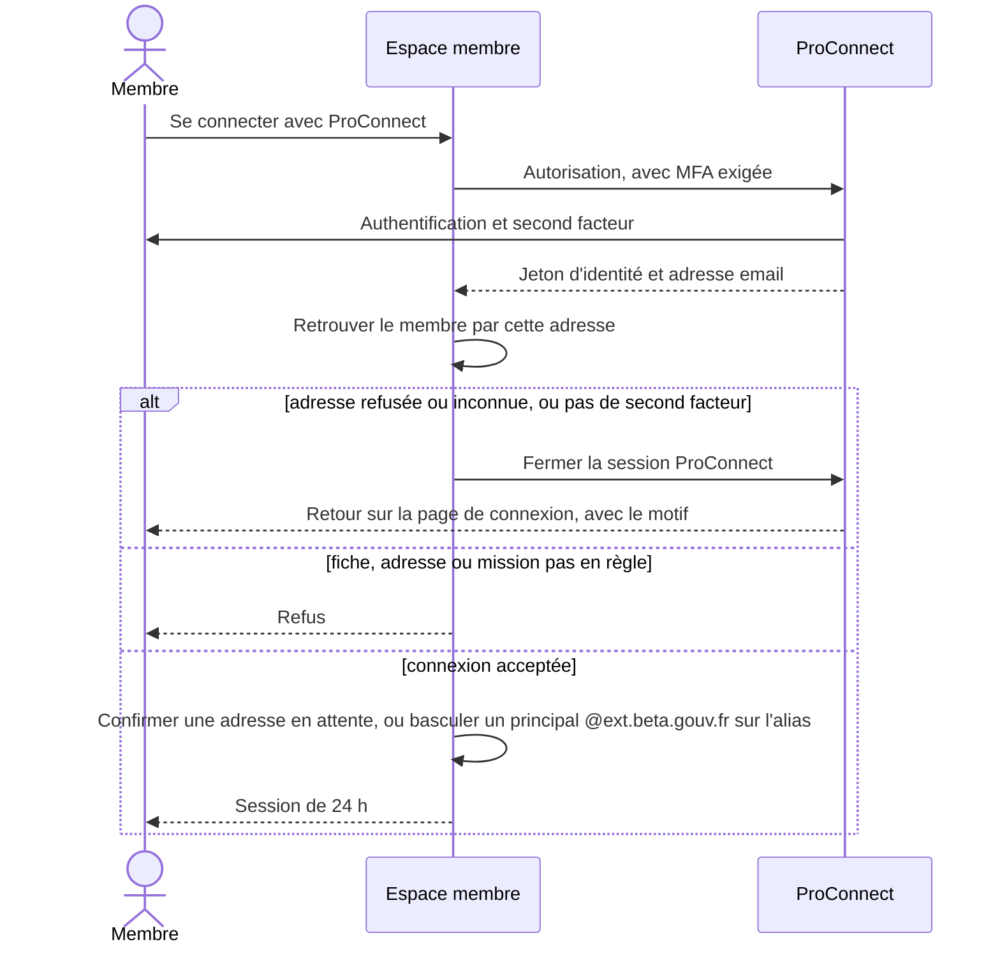

# Connexion à l'espace membre

La connexion passe par **ProConnect avec double authentification (MFA)**. Le niveau d'authentification (`acr`) est exigé à la demande, puis relu dans le jeton d'identité.

Un membre est retrouvé par l'adresse que renvoie ProConnect, comparée à :

- son email principal ;
- une boîte ou un alias Dimail rattaché à sa fiche (hors adresse supprimée de Dimail) ;
- son adresse principale en attente, le temps de la confirmer.

L'email perso (`secondary_email`) n'est jamais un identifiant ProConnect, et un membre qui s'en sert voit un message qui le lui dit. Les adresses `@ext.beta.gouv.fr` sont refusées : il faut passer par l'alias `@beta.gouv.fr`.

Le lien magique par email reste ouvert pendant la transition, pour les comptes existants pas encore passés à ProConnect. Il est isolé dans `src/lib/auth/legacyEmailLogin/`, dont le README décrit les phases et la suppression.

La session dure 24 h, comptées depuis la connexion. Les actions admin sensibles exigent une session ProConnect avec MFA.

## Personas et scénarios

Le domaine historique `@ext.beta.gouv.fr` n'est pas le suffixe actuel `prenom.nom.ext@beta.gouv.fr`.

| Persona                       | Principal                     | Perso         | Dimail                                                       | Se connecte                                                          |
| ----------------------------- | ----------------------------- | ------------- | ------------------------------------------------------------ | -------------------------------------------------------------------- |
| Intra                         | adresse d'administration      | souvent aucun | aucune, ou boîte `prenom.nom@beta.gouv.fr`                   | ProConnect avec l'une ou l'autre                                     |
| Extra ou attributaire         | `prenom.nom.ext@beta.gouv.fr` | adresse perso | cette boîte                                                  | ProConnect avec sa boîte (accès à la boîte envoyé sur l'email perso) |
| Membre historique             | `prenom.nom@beta.gouv.fr`     | adresse perso | cette boîte, ou cet alias vers une boîte `@ext.beta.gouv.fr` | ProConnect avec son principal                                        |
| Ancien domaine, avec alias    | `prenom.nom@ext.beta.gouv.fr` | adresse perso | boîte `@ext.beta.gouv.fr` + alias `@beta.gouv.fr`            | ProConnect avec l'alias, qui devient son principal                   |
| Ancien domaine, sans alias    | `prenom.nom@ext.beta.gouv.fr` | adresse perso | boîte `@ext.beta.gouv.fr` seule                              | lien magique jusqu'à la migration des adresses ext                   |
| Fiche sans adresse ProConnect | aucun, ou adresse perso       | adresse perso | aucune                                                       | lien magique, abandonnée à la coupure                                |
| Nouvel arrivant               | aucun                         | adresse perso | aucune                                                       | refusé jusqu'à la validation, puis ProConnect avec la boîte créée    |
| Adresse perdue                | adresse morte                 |               |                                                              | exception du support, puis nouvelle adresse confirmée par ProConnect |

## Connexion ProConnect, pas à pas

## Email principal

L'email principal est l'identifiant ProConnect : il ne s'écrit jamais directement.

- **Une adresse Dimail du membre** (boîte ou alias `@beta.gouv.fr`, active) devient principale directement, depuis sa fiche.
- **Toute autre adresse** est posée en attente pour 7 jours. Elle devient principale quand le membre se connecte avec elle sur ProConnect, ce qui prouve qu'elle lui appartient.
- **L'email perso** suit le même chemin. À la confirmation, les deux adresses s'inversent : l'ancien principal devient l'email perso. Un admin peut proposer cette inversion depuis la fiche.

Peuvent poser une adresse en attente :

- le membre, en session ProConnect avec MFA ;
- le membre, en session lien magique ouverte grâce à une exception du support (adresse perdue) ;
- un admin en session MFA, pour quelqu'un d'autre.

L'email perso ne se modifie qu'en session ProConnect avec MFA, et doit être unique.

## Synchro Dimail

La synchro (`sync-dinum-emails`) recopie les boîtes et alias Dimail dans `dinum_emails` :

- une adresse que Dimail ne connaît plus est marquée supprimée et ne permet plus de se connecter ;
- un admin peut rattacher une adresse à une fiche, et la synchro ne modifie plus ce rattachement ;
- le statut email d'un membre suit sa boîte, même quand son principal est ailleurs.

Un admin peut renvoyer un lien d'accès à la boîte d'un membre, vers son email perso.
